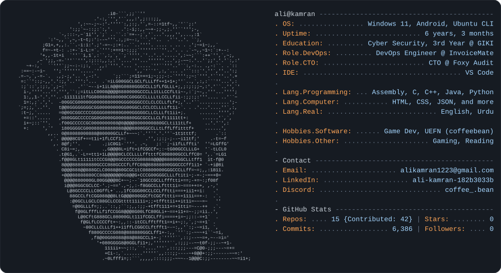

<a href="https://github.com/alikamran21">
  <picture>
    <source media="(prefers-color-scheme: light)" srcset="light_mode.svg">
    
  </picture>
</a>

---

## 🛠️ Tech stack

---

## 📊 GitHub stats

 

---

## 👻 Contribution Pac-Man

<picture>
  <source media="(prefers-color-scheme: dark)" srcset="https://raw.githubusercontent.com/alikamran21/alikamran21/output/pacman-contribution-graph-dark.svg">
  <source media="(prefers-color-scheme: light)" srcset="https://raw.githubusercontent.com/alikamran21/alikamran21/output/pacman-contribution-graph.svg">
  
</picture>

---

## 📫 Connect with me

